# تمرین عملی HTTP

درس مهندسی اینترنت پاییز ۱۴۰۵

## معرفی پروژه

هدف این پروژه قرار دادن یک Reverse Proxy در مقابل یک سرویس قدیمی است که خودش قابلیت احراز هویت ندارد. برای این کار از Kong Gateway به‌عنوان Reverse Proxy و از `go-httpbin` به‌عنوان سرویس Backend استفاده شده است.

احراز هویت در Kong و با JWT انجام می‌شود. درخواست‌هایی که توکن معتبر ندارند قبل از رسیدن به سرویس اصلی رد می‌شوند.

## ۱. اجرای سرویس فقط در شبکهٔ داخلی

برای محدودکردن دسترسی به یک سرویس، می‌شود آن را فقط روی یک آدرس داخلی اجرا کرد و با کمک Firewall دسترسی از شبکه‌های خارجی را مسدود کرد. همچنین می‌توان سرویس را در یک شبکه خصوصی قرار داد و فقط از طریق یک Reverse Proxy به آن دسترسی داد.

در این پروژه، سرویس `go-httpbin` در شبکه داخلی Docker اجرا شده و پورت `8081` آن روی میزبان منتشر نشده است. در مقابل، Kong هم به شبکه ورودی و هم به شبکه داخلی متصل است و درخواست‌ها را به Backend منتقل می‌کند.

برای آزمایش این موضوع، دستور `docker port ie-legacy` خروجی خالی داشت و اتصال مستقیم به `localhost:8081` ناموفق بود. اما درخواست دارای JWT معتبر از مسیر Kong با موفقیت به Backend رسید.

این روش باعث می‌شود سرویس قدیمی مستقیما در معرض درخواست‌های ورودی قرار نگیرد.

## ۲. فلسفه TLS Termination

در TLS Termination، ارتباط HTTPS در یک نقطه واسط مانند Reverse Proxy خاتمه پیدا می‌کند. در این حالت Proxy گواهی دیجیتال و فرایند TLS Handshake را مدیریت می‌کند، درخواست‌های رمزنگاری‌شده را رمزگشایی می‌کند و بعد آن‌ها را به Backend می‌فرستد.

مزیت اصلی این روش این است که برای اضافه‌کردن HTTPS، لازم نیست کد سرویس قدیمی را تغییر دهیم. همچنین مدیریت گواهی‌ها و تنظیمات TLS در یک نقطه متمرکز می‌شود.

البته اگر ارتباط بین Proxy و Backend از HTTP استفاده کند، آن بخش از مسیر رمزنگاری‌شده نیست. بنابراین باید شبکه داخلی محدود و قابل اعتماد باشد یا برای مسیر Backend هم TLS در نظر گرفته شود.

روش‌های JWT Authentication و TLS Termination دو وظیفه متفاوت دارند: JWT اعتبار توکن و هویت درخواست‌کننده را بررسی می‌کند درحالی‌که TLS از اطلاعات هنگام انتقال محافظت می‌کند.

در پیاده‌سازی فعلی این تمرین، ارتباط ورودی روی HTTP و پورت `80` است؛ بنابراین TLS Termination به‌صورت نظری توضیح داده شده و هنوز HTTPS پیکربندی نشده است.

## ۳. پیاده‌سازی JWT Authentication Proxy

### ابزارهای استفاده‌شده

- ابزار Docker و Docker Compose برای اجرای سرویس‌ها
- ابزار Kong Gateway برای Reverse Proxy و JWT Authentication
- ابزار go-httpbin برای شبیه‌سازی سرویس قدیمی
- ابزار Python برای تولید توکن‌های آزمایشی

### ساختار پروژه

```text
http-hands-on/
├── docker-compose.yml
├── kong/
│   └── kong.yml
├── scripts/
│   └── generate_token.py
├── .gitignore
└── README.md
```


### معماری

تصویر زیر روند کلی محافظت از یک Backend با استفاده از API Gateway و اعتبارسنجی Access Token را نشان می‌دهد.

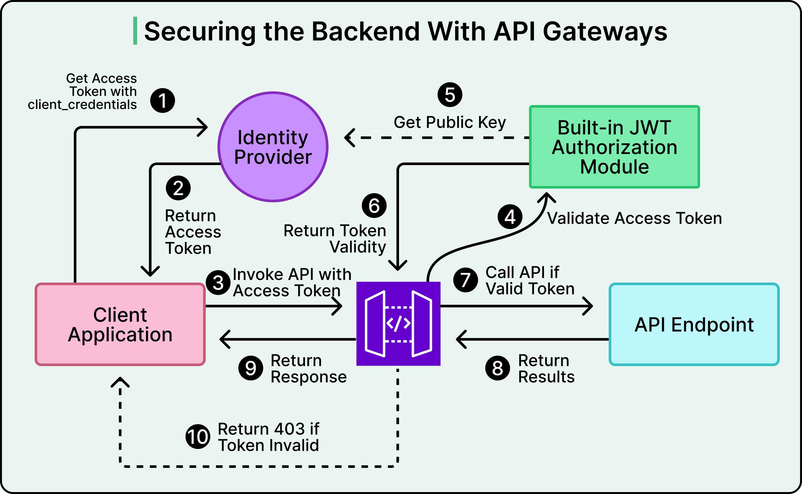

> **نکته:** این تصویر یک معماری عمومی را نشان می‌دهد. در پیاده‌سازی این تمرین، از Kong Gateway و JWT با الگوریتم HS256 استفاده شده و اعتبارسنجی توکن با کلید مشترک انجام می‌شود. همچنین توکن نامعتبر با کد `401 Unauthorized` رد می‌شود.

معماری پیاده‌سازی‌شده در این پروژه:

```text
Client
   |
   | HTTP :80
   v
Kong Reverse Proxy
   |
   | JWT Authentication
   |
   +---- Invalid JWT ----> 401 Unauthorized
   |
   +---- Valid JWT ------> go-httpbin :8081
```

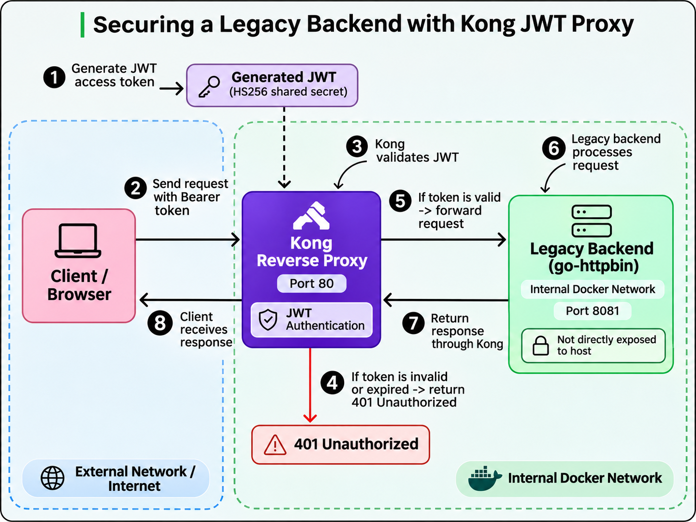

تنها پورت منتشرشده برای درخواست‌های سرویس، پورت `80` متعلق به Kong است. سرویس Backend روی شبکه داخلی Docker قرار دارد.

### اجرای پروژه

برای راه‌اندازی:

```bash
sudo docker compose up -d
```

برای بررسی وضعیت:

```bash
sudo docker compose ps
```

برای ساخت یک JWT معتبر:

```bash
TOKEN=$(python scripts/generate_token.py)
```

برای آزمایش دسترسی با JWT:

```bash
curl -i http://localhost/anything \
  -H "Authorization: Bearer $TOKEN"
```

برای آزمایش درخواست بدون توکن:

```bash
curl -i http://localhost/anything
```


### نتایج آزمایش‌ها

برای بررسی عملکرد Reverse Proxy و صحت احراز هویت JWT، درخواست‌های مختلفی به Kong ارسال شد. همچنین وضعیت Containerها و امکان دسترسی مستقیم به Backend بررسی شد.

#### ۱. بررسی وضعیت Containerها

با اجرای دستور `sudo docker compose ps` مشخص شد که هر دو سرویس `kong` و `legacy` در حال اجرا هستند. سرویس Kong نیز در وضعیت `healthy` قرار دارد. پورت `80` میزبان به Kong متصل شده، اما پورت Backend روی میزبان منتشر نشده است.

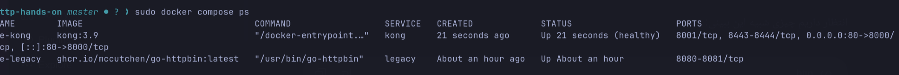

#### ۲. درخواست بدون JWT

درخواستی بدون هدر `Authorization` به مسیر `/anything` ارسال شد. Kong این درخواست را با کد `401 Unauthorized` و پیام `Unauthorized` رد کرد.

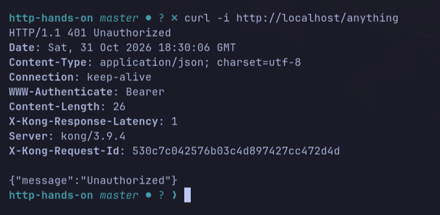

#### ۳. ارسال توکن با قالب نامعتبر

به‌جای JWT معتبر، رشتهٔ `invalid-token` در هدر `Authorization` ارسال شد. از آنجا که این مقدار ساختار صحیح JWT را نداشت، Kong پاسخ `401 Unauthorized` با پیام `Bad token; invalid JSON` برگرداند.

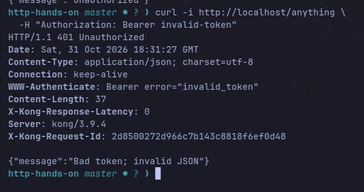

#### ۴. درخواست با JWT معتبر

ابتدا یک JWT با الگوریتم `HS256` و Secret تعریف‌شده در تنظیمات Kong تولید شد. سپس توکن در هدر `Authorization` ارسال شد و پاسخ `200 OK` دریافت شد.

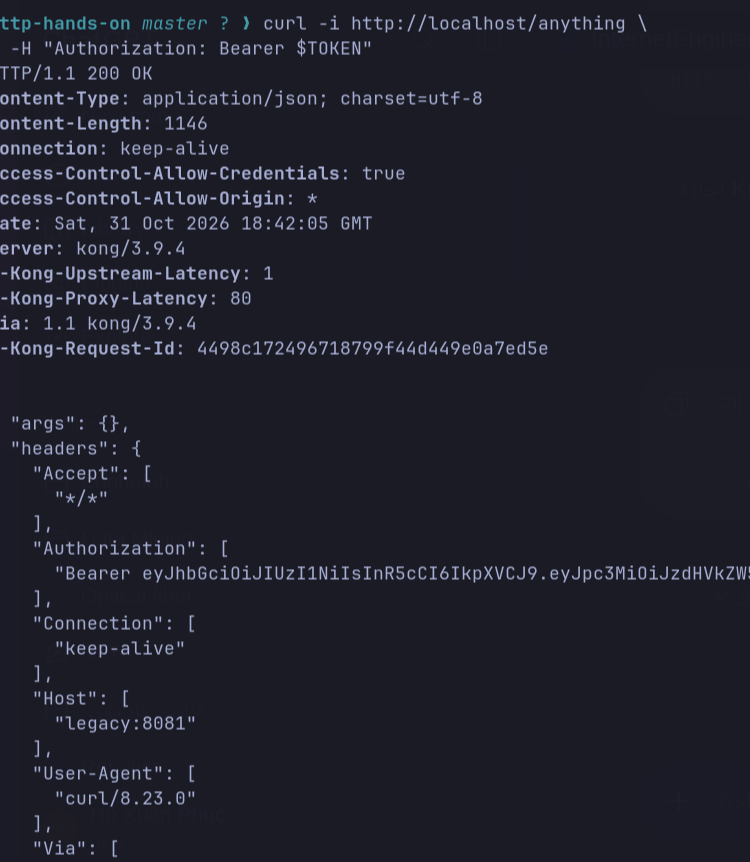

در پاسخ سرویس `go-httpbin`، مقدار `url` برابر `http://legacy:8081/anything` بود. این موضوع نشان می‌دهد که درخواست معتبر از طریق Kong به Backend داخلی رسیده است.

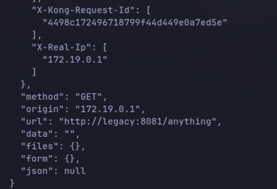

همچنین هدر `X-Consumer-Username` با مقدار `student` و هدر `X-Credential-Identifier` با مقدار `student-key` مشاهده شدند. این اطلاعات نشان می‌دهند که Kong مصرف‌کنندهٔ تعریف‌شده را شناسایی کرده است. هدرهای `X-Forwarded-*` نیز اطلاعات درخواست عبوری از Proxy را نشان می‌دهند.

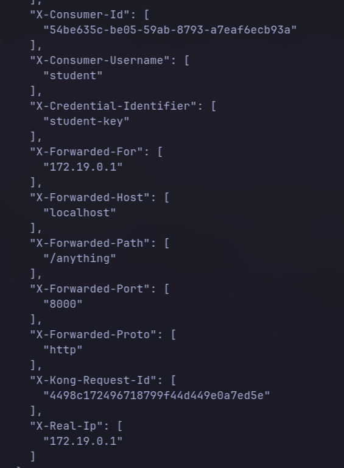

#### ۵. JWT با امضای نامعتبر

یک JWT با ساختار صحیح، اما با Secret اشتباه تولید و ارسال شد. Kong امضای توکن را نامعتبر تشخیص داد و پاسخ `401 Unauthorized` همراه با پیام `Invalid signature` برگرداند.

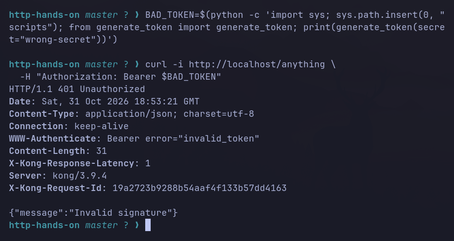

#### ۶. JWT منقضی‌شده

یک JWT با مقدار `exp` مربوط به زمان گذشته ساخته و ارسال شد. Kong انقضای آن را تشخیص داد و درخواست با کد `401 Unauthorized` و پیام `token expired` رد شد.

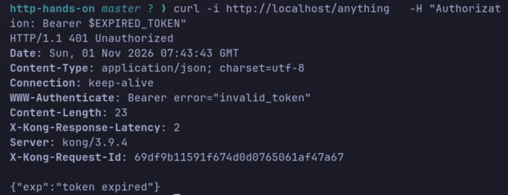

#### ۷. بررسی دسترسی مستقیم به Backend

با اجرای دستور `sudo docker port ie-legacy` مشخص شد که هیچ پورتی از Container مربوط به سرویس قدیمی روی میزبان منتشر نشده است.

همچنین تلاش برای اتصال مستقیم به `localhost:8081` با خطای `Failed to connect` مواجه شد. بنابراین Backend از این مسیر مستقیماً قابل دسترسی نیست، درحالی‌که درخواست معتبر از طریق Kong به آن می‌رسد.

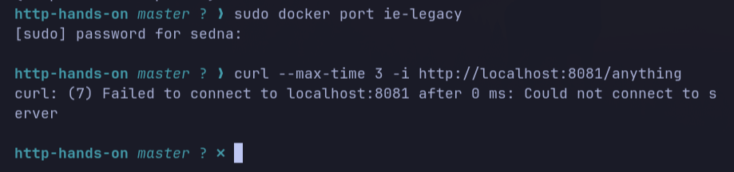

این آزمایش‌ها نشان می‌دهند که Kong درخواست‌های بدون توکن یا دارای JWT نامعتبر را رد می‌کند و درخواست دارای JWT معتبر را به سرویس داخلی منتقل می‌کند.


### ملاحظات امنیتی

کلید JWT استفاده‌شده در این پروژه صرفاs برای آزمایش محلی است و نباید در یک سرویس واقعی به‌صورت عمومی در مخزن نگهداری شود. در محیط واقعی باید از کلید محرمانهٔ امن، HTTPS، محدودیت دسترسی شبکه و تنظیمات مناسب مدیریت توکن استفاده کرد.

## استفاده از ابزار هوش مصنوعی

برای یادگیری و بررسی مفاهیم Docker Networking، Reverse Proxy، JWT Authentication و TLS Termination از ChatGPT استفاده شده است. در طراحی اولیه فایل‌های پیکربندی، نوشتن اسکریپت تولید JWT، رفع خطاهای Kong و آماده‌سازی متن مستندات هم کمک گرفته شده است. پیاده‌سازی و آزمایش‌ها در محیط Omarchy انجام شده‌اند.

- **نام مدل:** GPT-6
- **موارد استفاده:** توضیح مفاهیم، راهنمایی پیاده‌سازی، رفع خطا، مستندسازی و طراحی تست‌ها.